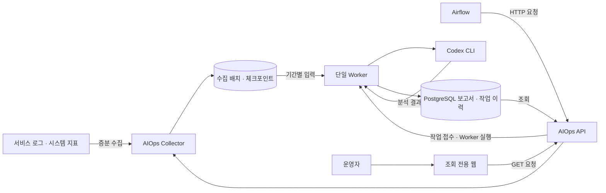

# 타르코프 도서관 · AIOps

**갱신일: 2026.10.31**

타르코프 도서관의 **서비스 로그와 시스템 지표를 수집하고, Codex로 운영 보고서를 만드는 프로젝트**입니다. 일일 점검에 장애·성능 분석을 함께 담고, 일일 결과를 모아 주간·월간 보고서를 생성합니다.

Airflow가 정해진 시간에 HTTP API를 호출하고, 운영자는 조회 전용 웹에서 보고서와 수집·작업 상태를 확인합니다. 원본 로그나 서비스 설정을 변경하지 않으며, 분석 결과에 따른 자동 복구·배포는 수행하지 않습니다.

## 전체 서비스에서 맡은 역할

Airflow는 게임 데이터 갱신과 정기 작업을, FastAPI·Next.js는 사용자 기능과 화면을 담당합니다. 이 프로젝트는 각 서비스가 남긴 기록을 읽고 운영 상태를 분석합니다.



AIOps는 로그와 Codex 인증을 사용할 수 있는 호스트에서 실행합니다. Docker의 Airflow는 API로 요청하므로 프로젝트·원본 로그·인증 파일을 컨테이너에 공유할 필요가 없습니다. DAG와 스케줄은 별도 Airflow 프로젝트에서 관리합니다.

## 제공하는 기능

| 영역          | 하는 일                                                                | 주요 코드                                     |
| ------------- | ---------------------------------------------------------------------- | --------------------------------------------- |
| 로그 수집     | 파일의 새로 추가된 부분 읽기, 회전·중단 복구, 서비스별 수집 한도 배분  | `src/aiops/collectors/files.py`, `store.py`   |
| 정규화·마스킹 | 시각·수준·서비스 정규화, 다중행 결합, 민감정보 마스킹, 오류·HTTP 집계  | `src/aiops/collectors/parse.py`, `redact.py`  |
| 시스템 지표   | CPU·메모리·디스크와 선택한 Docker 컨테이너 상태·자원 조회              | `src/aiops/collectors/system.py`, `docker.py` |
| 정기 보고서   | 한국 시간 기준 기간 입력, 누락 표시, 수정본·하위 보고서 의존 관계 관리 | `src/aiops/reporting/`                        |
| AI 분석       | 기존 Codex 로그인 재사용, 구조화된 결과와 근거 검증                    | `src/aiops/providers/`                        |
| 작업 처리     | PostgreSQL 작업 큐, 단일 Worker 잠금, 실패 분류와 재시도               | `src/aiops/worker.py`, `storage/`             |
| HTTP API      | 수집·보고서 접수·Worker 실행, 공개 진행 메시지 SSE 전송                | `src/aiops/api.py`, `streaming.py`            |
| 조회 웹       | 보고서 목록·상세, 수집 범위, 작업 상태와 최근 추이                     | `src/aiops/web/`, `web_server.py`             |

Docker 수집은 컨테이너 상태와 자원 지표를 조회합니다. 컨테이너 stdout·stderr 로그를 직접 가져오는 기능은 현재 포함하지 않습니다.

## 수집부터 보고서 조회까지

### 수집과 분석은 따로 실행합니다

`collect`는 Codex를 실행하지 않습니다. 파일별 체크포인트 이후의 로그를 읽어 정규화·마스킹한 배치와 지표를 저장합니다. 첫 실행은 최근 일부만 읽으며, 다음 실행부터 이어서 수집합니다.

분석할 때는 저장한 데이터를 기간별로 묶어 Codex에 전달합니다. 원문에 시각이 없는 기록은 임의로 시간을 붙이지 않고, 수집 누락과 함께 보고서의 한계로 표시합니다. 수집 성공·분석 완료·수집 범위 충족은 각각 별도로 판단합니다.

### 일일 결과를 주간·월간으로 모읍니다

| 보고서 | 기본 분석 대상                   | 기준                                         |
| ------ | -------------------------------- | -------------------------------------------- |
| 일일   | 전날 로그와 시스템 지표          | 종합 요약·장애 분석·성능 분석                |
| 주간   | 지난 월요일~일요일의 일일 보고서 | 반복 문제·변화 통합                          |
| 월간   | 지난달 일일 보고서 전체          | 주간 보고서는 보조 참고, 건수 중복 합산 방지 |

기간은 한국 시간의 달력 날짜로 계산합니다. 지연 로그나 하위 보고서가 바뀌면 새 수정본을 만들고, 같은 입력의 완료 결과는 재사용합니다. 근거가 부족하면 정상으로 단정하지 않고 `INSUFFICIENT_DATA`로 표시합니다.

### Airflow가 접수하고 Worker가 처리합니다

PostgreSQL을 설정한 운영 환경에서는 보고서 요청이 작업 큐에 등록됩니다. Airflow가 Worker API를 호출하면 한 건을 처리하고 종료하므로 별도 상시 Worker 서비스가 필요하지 않습니다.

SSE API는 Codex가 공개적으로 출력하는 진행 메시지·실행 이벤트·토큰 사용량과 최종 작업 상태를 전달합니다. Airflow에서 이를 받아 로그에 기록할 수 있습니다. 내부 추론 본문·도구 인수·출력은 전달하지 않습니다.

조회 웹은 보고서·수집·작업 현황을 보여줍니다. API 키는 웹 서버에서만 사용하며 브라우저에 전달하지 않습니다. 실행·재시도·설정 변경 버튼은 제공하지 않습니다.

## 일일 심화 조사 · 대응 가이드

일일 분석 완료 후 별도 단계에서 기본 상태를 조회하고, Codex가 선택한 추가 조회를 실행한 뒤 우선 행동과 대응안을 정리합니다. “지금 할 일”에는 대응 시점·결과별 판단·완료 기준을, 상세에는 기대 효과·예상 부작용·복구 확인·되돌리기를 표시합니다. 조회는 허용된 고정 기능만 사용하며 조치를 자동 실행하지 않습니다. 기존 일일 보고서와 조사 이력은 별도로 보존합니다.

이 기능은 마이그레이션 3과 일일 Airflow DAG의 추가 호출이 필요합니다. 주간·월간은 저장된 조사 요약만 참고합니다. [배포·API 호출·조회 범위](docs/INVESTIGATION.md)를 참고하세요.

## 주요 기술

의존성 선언은 [pyproject.toml](pyproject.toml), 설치 버전은 [uv.lock](uv.lock)을 기준으로 합니다.

| 기술                    | 용도                                   |
| ----------------------- | -------------------------------------- |
| Python 3.12+ · uv       | CLI·서버 실행, 의존성 관리             |
| FastAPI · Uvicorn       | HTTP API와 조회 웹 서버                |
| Codex CLI               | 기존 로그인 기반 운영 분석             |
| PostgreSQL · Psycopg    | 보고서 원본, 작업 큐와 시도 이력       |
| SQLite                  | 수집 체크포인트와 로컬 보고서 카탈로그 |
| Pydantic · PyYAML       | 입력·출력 검증과 수집 설정             |
| psutil · Docker SDK     | 호스트·컨테이너 상태 조회              |
| HTML · CSS · JavaScript | 별도 Node 빌드가 없는 조회 전용 웹     |

## 디렉터리 구조

```text
.
├── src/aiops/
│   ├── collectors/         # 증분 수집, 파서, 마스킹, 지표
│   ├── providers/          # Codex 실행과 공개 진행 이벤트
│   ├── reporting/          # 기간 입력, 집계, 버전과 의존 관계
│   ├── storage/            # PostgreSQL·SQLite 저장소와 SQL
│   ├── web/                # 조회 웹 HTML·CSS·JavaScript
│   ├── api.py              # 수집·보고서·Worker HTTP API
│   ├── web_server.py       # 웹 제공과 GET 조회 프록시
│   ├── worker.py           # 단일 작업 처리
│   └── cli.py              # aiops 명령
├── config/                 # 수집 설정과 샘플 입력
├── prompts/                # 분석 지침
├── scripts/                # 최초 준비와 개별 서버 관리
├── deploy/                 # DB 준비 SQL, 선택적 Worker 서비스 예제
├── tests/                  # 대역 기반 테스트와 선택적 통합 검증
├── docs/                   # 기능 계약·운영 절차·검증 기록
├── aiops_data/             # 수집 배치·체크포인트·보고서, Git 제외
├── log_history/            # API·웹 날짜별 실행 로그, Git 제외
└── restart.sh              # API·웹 통합 시작·재시작·상태·종료
```

## 실행 환경과 설정

macOS 또는 Linux에서 Python 3.12 이상과 `uv`를 사용합니다. 파일 잠금과 POSIX 프로세스 그룹을 사용합니다. Codex를 실행할 계정으로 CLI 설치와 로그인을 먼저 확인합니다.

```sh
npm install -g @openai/codex@latest
codex login --device-auth
codex login status
uv sync --locked
```

명령은 프로젝트 루트에서 실행합니다. `uv run`은 프로젝트 가상환경을 사용하므로 별도 활성화가 필요하지 않습니다.

기존 `.env`가 없다면 [.env.example](.env.example)을 참고해 작성합니다. 아래 `<...>`는 예시 자리 표시자이며 실제 값으로 바꿔야 합니다. 운영 주소·포트·계정·비밀값은 문서에 기록하지 않습니다.

```dotenv
AIOPS_DATABASE_URL="host=<DB_HOST> port=<DB_PORT> dbname=<DB_NAME> user=<DB_USER>"
PGPASSWORD="<DB_PASSWORD>"
AIOPS_SOURCES_CONFIG=config/log_sources.yaml
AIOPS_API_TOKEN=<GENERATED_SECRET>
```

| 설정                                              | 용도                                          |
| ------------------------------------------------- | --------------------------------------------- |
| `AIOPS_DATABASE_URL` · `PGPASSWORD`               | 보고서·작업 큐 DB 접속                        |
| `AIOPS_SOURCES_CONFIG`                            | 수집 대상과 파일 경로 설정                    |
| `AIOPS_DATA_DIR`                                  | 모든 실행에서 공유할 데이터 디렉터리          |
| `AIOPS_API_TOKEN`                                 | Airflow·웹 서버가 API 호출 시 사용하는 비밀키 |
| `AIOPS_API_HOST` · `AIOPS_API_PORT`               | API 수신 주소와 포트                          |
| `AIOPS_WEB_HOST` · `AIOPS_WEB_PORT`               | 조회 웹 수신 주소와 포트                      |
| `AIOPS_WEB_API_URL`                               | 웹 서버가 조회하는 API 주소                   |
| `AIOPS_CODEX_BIN` · `AIOPS_MODEL`                 | Codex 실행 파일과 요청 모델                   |
| `AIOPS_TIMEOUT_SECONDS` · `AIOPS_MAX_INPUT_BYTES` | 분석 시간과 입력 크기 한도                    |

CLI는 `--env-file .env`를 지정할 때 파일을 읽으며 기존 환경변수가 우선합니다. 관리 스크립트는 `.env`를 사용합니다. 모델을 지정하지 않으면 CLI 기본 모델을 사용하고 실제 모델명을 추정해 기록하지 않습니다. 인증과 실행 방식은 [Provider 안내](docs/CODEX_PROVIDER.md)를 참고하세요.

## 운영 실행과 확인

전용 DB와 접속 계정, 수집 설정을 준비한 뒤 다음 두 단계로 시작합니다.

```sh
# 최초 준비: 테이블 초기화·기존 보고서 이전·배치 등록·DB 확인
./scripts/init.sh

# API와 조회 웹을 함께 시작·재시작
./restart.sh
```

테이블은 `public` 스키마의 `aiops_` 접두사를 사용합니다. DB 준비 절차는 [PostgreSQL·Worker 안내](docs/POSTGRES_WORKER.md)를 따릅니다. 스키마 적용은 초기화 명령에서 수행하며 일반 조회가 자동 마이그레이션을 실행하지 않습니다.

이후 Airflow에서 **수집 → 보고서 접수 → Worker 실행 → 작업 완료 확인**을 연결합니다. 수집은 분석과 별도 주기로 실행합니다. [API 호출 안내](docs/AIRFLOW_API.md)와 [진행 로그 수신 예시](docs/WORKER_STREAM.md)를 참고하세요.

```sh
./restart.sh status       # API·웹 상태
./restart.sh stop         # API·웹 종료

# 수동 진단
uv run aiops --env-file .env doctor
uv run aiops --env-file .env status
```

API만 관리할 때는 `./scripts/restart-api.sh`, 웹만 관리할 때는 `./scripts/restart-web.sh`에 같은 `status`·`stop` 명령을 사용합니다. 실행 로그는 `log_history/api-YYYY-MM-DD.log`, `web-YYYY-MM-DD.log`에 한국 시간 날짜별로 저장합니다. 재부팅 후 자동 시작은 별도 설정이 필요합니다.

### 로컬에서 수집·분석 확인

DB 없이 샘플을 확인하려면 다음 명령을 사용합니다. 기본 테스트 수집은 fixture 로그를 사용합니다.

```sh
uv run aiops doctor
uv run aiops collect --all
uv run aiops analyze --input config/sample.json
```

운영 설정을 사용한 수동 점검은 다음과 같습니다. 아래는 Airflow 호출을 대신하는 진단 명령이며 매번 전부 실행할 필요는 없습니다.

```sh
uv run aiops --env-file .env collect --all
uv run aiops --env-file .env report run --type daily
uv run aiops --env-file .env worker --once
```

PostgreSQL 모드의 `report run`은 큐 등록까지만 합니다. DB 설정이 없는 로컬 모드에서는 직접 분석하므로 별도 Worker 실행이 필요하지 않습니다. 주간·월간은 하위 일일 보고서가 완료된 뒤 `--type weekly`, `--type monthly`로 요청합니다.

## 운영할 때 알아둘 점

- **수집 범위:** `partial`은 일부 누락이나 읽기 한도가 있어도 배치가 저장됐다는 뜻입니다. 새 로그 0건과 수집 실패를 구분하고 `coverage`·경고를 확인합니다.
- **시간 필터:** `--since`는 이번 증분 읽기의 필터이며 과거 구간 전체를 재수집하지 않습니다. 정기 수집에는 붙이지 않습니다.
- **저장과 복구:** 수집 파일은 DB 등록이 실패해도 보존합니다. 같은 DB를 쓰는 실행은 같은 호스트와 `AIOPS_DATA_DIR`를 사용합니다. 체크포인트나 이전 배치를 임의로 삭제하지 않습니다.
- **민감정보:** 마스킹은 규칙 기반입니다. 최초 운영 배치를 검토한 뒤 외부 분석에 사용하고 `.env`·인증 파일·원본 로그·운영 결과를 커밋하지 않습니다.
- **분석 실패:** 인증·사용량 제한·잘못된 결과는 자동 재시도하지 않습니다. 원인을 해결한 뒤 작업 상태에 맞게 재접수·재시도합니다.
- **종료 코드:** `0`은 성공, `10`은 수집·입력의 불완전성, `11`은 DB 오류입니다. 분석 오류는 종류별 코드를 사용하며 상세 기준은 관련 기능 문서를 따릅니다.

## 개발 환경과 검증

```sh
uv run pytest -q

# 실제 Codex 호출이 필요한 경우에만 명시적으로 실행
AIOPS_RUN_INTEGRATION=1 uv run pytest -q -m integration
```

기본 테스트는 실제 Codex·PostgreSQL·네트워크·Docker daemon 없이 대역으로 실행합니다. 실제 PostgreSQL 검증은 [별도 opt-in 절차](docs/POSTGRES_WORKER.md)를 사용합니다.

## 상세 문서

| 문서                                                                              | 내용                                 |
| --------------------------------------------------------------------------------- | ------------------------------------ |
| [수집 안내](docs/COLLECTION.md)                                                   | 증분 읽기·회전·한도·체크포인트·보관  |
| [정기 보고서](docs/REPORTING.md)                                                  | 기간·근거·수정본·누락·장애·성능 분석 |
| [PostgreSQL·Worker](docs/POSTGRES_WORKER.md)                                      | DB 준비·마이그레이션·큐·재시도·복구  |
| [Airflow API](docs/AIRFLOW_API.md)                                                | 외부 호출 계약과 작업 상태           |
| [Worker 스트리밍](docs/WORKER_STREAM.md)                                          | SSE 이벤트와 Airflow 로그 수신       |
| [일일 심화 조사](docs/INVESTIGATION.md) | 현재 상태 조회·원인 확인·대응 가이드·일일 DAG 연결 |
| [조회 웹](docs/WEB.md)                                                            | 화면·조회 API·접근 방식              |
| [Codex Provider](docs/CODEX_PROVIDER.md)                                          | 실행·인증·모델·진행 이벤트           |
| [보안](docs/SECURITY.md) · [배치 계약](docs/BATCH_CONTRACT.md)                    | 읽기 경계·마스킹·입출력 기준         |
| [Phase 1](docs/PHASE1.md) · [Phase 2](docs/PHASE2.md) · [Phase 3](docs/PHASE3.md) | 설계와 개발 범위                     |

관련 프로젝트: [Airflow](https://github.com/eft-library/eft-library-airflow), [Backend](https://github.com/eft-library/eft-library-back), [Frontend](https://github.com/eft-library/eft-library-front), [Kafka Consumers](https://github.com/eft-library/eft-library-kafka).
